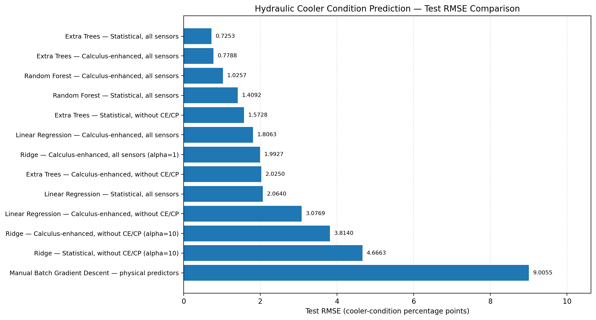

# AI-Driven Hydraulic System Health Prediction and Optimization
**B.Tech Artificial Intelligence & Machine Learning Coursework Project with Applied Calculus**

---

## 1. Project Title and Objectives
**Title:** AI-Driven Hydraulic System Health Prediction and Optimization  
**Academic Focus:** B.Tech AIML Syllabus + Applied Calculus Integration  

### Primary Objectives:
1. **Bridge AIML & Calculus:** Implement and demonstrate core mathematical syllabus concepts—manual Batch Gradient Descent, composite Trapezoidal integration, finite-difference differentiation, and partial derivative sensitivity analysis—on real-world industrial telemetry data.
2. **Predict Continuous Cooler Degradation:** Predict the continuous health of a hydraulic test rig's cooling circuit (`cooler_condition`, 3%–100%) using 17 multi-rate physical sensor streams.
3. **Rigorous Experimental Validation:** Evaluate algorithms using strict 5-fold cross-validation on training data only, audit the contiguous operating block phenomenon, address undefined $R^2$ in zero-variance chronological slices, and avoid target proxy bias.
4. **Deploy Portable User Interface:** Deliver an interactive Streamlit application with input validation, feature transformation, model diagnostics, and calculus exploration.

---

## 2. Problem Statement and Motivation
Hydraulic systems are essential in industrial manufacturing presses, aerospace actuation systems, and heavy construction equipment. These systems operate under high pressure (up to 250 bar) and transfer mechanical power via circulating hydraulic fluid.

When the secondary cooling-filtration circuit fails or loses heat dissipation efficiency:
- Fluid temperature escalates rapidly beyond safe operating limits (40°C–60°C).
- Oil viscosity plummets, causing severe boundary lubrication breakdown and internal pump wear.
- Fluid cavitation and seal degradation lead to catastrophic plant downtime and costly overhauls.

Developing a data-driven condition monitoring pipeline enables predictive maintenance, giving operators advance warning before catastrophic failure occurs.

---

## 3. Dataset Source, Structure, and Sensors
The project utilizes the benchmark **UCI Condition Monitoring of Hydraulic Systems Dataset**, experimentally gathered by ZeMA gGmbH at Saarland University (Saarbrücken, Germany).

- **Total Working Cycles:** 2,205 constant load cycles (each cycle duration = 60 seconds).
- **Missing Values:** Exactly 0 missing values across all files.
- **Data Matrix Layout:** Each sensor file contains 2,205 rows (one per cycle) and columns corresponding to time-step readings.

### Sensor Telemetry Specification:
| Sensor | Physical Quantity | Unit | Sampling Rate | Readings / Cycle | Type |
|---|---|---|---|---|---|
| **PS1** | Pressure 1 | bar | 100 Hz | 6,000 | Physical |
| **PS2** | Pressure 2 | bar | 100 Hz | 6,000 | Physical |
| **PS3** | Pressure 3 | bar | 100 Hz | 6,000 | Physical |
| **PS4** | Pressure 4 | bar | 100 Hz | 6,000 | Physical |
| **PS5** | Pressure 5 | bar | 100 Hz | 6,000 | Physical |
| **PS6** | Pressure 6 | bar | 100 Hz | 6,000 | Physical |
| **EPS1** | Motor Power | W | 100 Hz | 6,000 | Physical |
| **FS1** | Volume Flow 1 | L/min | 10 Hz | 600 | Physical |
| **FS2** | Volume Flow 2 | L/min | 10 Hz | 600 | Physical |
| **TS1** | Temperature 1 | °C | 1 Hz | 60 | Physical |
| **TS2** | Temperature 2 | °C | 1 Hz | 60 | Physical |
| **TS3** | Temperature 3 | °C | 1 Hz | 60 | Physical |
| **TS4** | Temperature 4 | °C | 1 Hz | 60 | Physical |
| **VS1** | Vibration | mm/s | 1 Hz | 60 | Physical |
| **CE** | Cooling Efficiency (Virtual) | % | 1 Hz | 60 | Virtual Proxy |
| **CP** | Cooling Power (Virtual) | kW | 1 Hz | 60 | Virtual Proxy |
| **SE** | Efficiency Factor | % | 1 Hz | 60 | Virtual Proxy |

### Condition Labels (`profile.txt`):
1. **`cooler_condition`:** 3% (close to total failure, 732 cycles), 20% (reduced efficiency, 732 cycles), 100% (full efficiency, 741 cycles). Total: 2,205.
2. **`valve_condition`:** 100% (optimal), 90% (small lag), 80% (severe lag), 73% (near failure).
3. **`internal_pump_leakage`:** 0 (none), 1 (weak), 2 (severe).
4. **`accumulator_pressure`:** 130 bar (optimal), 115 bar (slightly reduced), 100 bar (severely reduced), 90 bar (critical).
5. **`stable_flag`:** 0 (stable conditions reached), 1 (transient/unstable conditions).

---

## 4. The Prediction Target and Its Meaning
- **Selected Target:** `cooler_condition` (Percentage health from 3% to 100%).
- **Justification:** Cooler degradation directly governs system thermal equilibrium. While valve and pump faults present discrete steps, cooling efficiency is a continuous thermodynamic parameter that enables continuous regression modeling.
- **Scientific Interpretation:** The predicted value represents estimated cooling capacity. It is **not** a failure date, remaining useful life (RUL), or probabilistic chance of failure.

---

## 5. Independent (X) and Dependent (y) Variables
- **Dependent Variable ($y$):** `cooler_condition`.
- **Independent Variables ($X$):** Engineered statistical metrics (mean, standard deviation, minimum, maximum) and calculus metrics (definite integrals, mean/max absolute derivatives, derivative variability) across all physical sensors.
- **Strict Leakage Prevention:** The other 4 condition labels (`valve_condition`, `internal_pump_leakage`, `accumulator_pressure`, `stable_flag`) are strictly dropped from the predictor matrix.
- **Virtual Sensor Treatment:** Models are trained and compared both **with** and **without** `CE` and `CP`. Because `CE` (Cooling Efficiency) is a computed virtual sensor directly calculated from cooling delta, it acts as a target proxy. Models excluding `CE`/`CP` rely on genuine physical sensors (temperatures `TS1`, `TS2`, flow `FS1`, and motor power `EPS1`).

---

## 6. Supervised vs Unsupervised vs Reinforcement Learning
- **Supervised Learning (Used Here):** The algorithm learns from labeled pairs $(\mathbf{x}_i, y_i)$. Model parameters are optimized by minimizing an explicit loss function between predictions $\hat{y}_i$ and known experimental labels $y_i$.
- **Unsupervised Learning:** Finds patterns or clusters in unlabeled data (e.g., k-means, PCA). It cannot predict a calibrated engineering target.
- **Reinforcement Learning:** An agent interacts with an environment via actions and reward signals over sequential Markov Decision Processes. It is not suitable for offline regression on static tabular sensor cycles.

---

## 7. Why This Project is a Regression Task
Physical degradation of heat exchangers is continuous. Although the experimental dataset set cooler condition to three benchmark values (3%, 20%, 100%), real industrial fluid degradation is continuous. Regression treats values as continuous quantities with numerical distances, enabling fine-grained intermediate estimation (e.g., predicting 65% capacity as fouling accumulates).

---

## 8. Training, Fitting, Splitting, and Prediction Protocol
1. **Split Protocol:** An 80/20 stratified random split creates a Training Set (1,764 cycles) and a Held-Out Test Set (441 cycles).
2. **Train-Only Parameter Fitting:** Preprocessing transformers (StandardScaler, MinMaxScaler, PCA) are fitted strictly on $X_{\text{train}}$. Test data $X_{\text{test}}$ is transformed using the previously stored training parameters, preventing data leakage.
3. **Cross-Validation:** 5-fold cross-validation is conducted strictly within the training set to guide all hyperparameter tuning and model selection.
4. **Final Held-Out Testing:** The test set is evaluated only once after model selection to estimate true generalization.

---

## 9. Data Preprocessing and Feature Scaling
Implemented from first principles in `src/preprocessing.py`:

### Z-score Normalization (Standardization):
$$z = \frac{x - \mu}{\sigma}$$
Where $\mu = \frac{1}{n} \sum x_i$ and $\sigma = \sqrt{\frac{1}{n} \sum (x_i - \mu)^2}$.  
Safe handling: If $\sigma = 0$ (constant feature), $\sigma$ is set to $1.0$ to avoid division by zero.

### Min-Max Normalization:
$$x_{\text{scaled}} = \frac{x - x_{\min}}{x_{\max} - x_{\min}}$$
Where $x_{\text{scaled}} \in [0, 1]$. If $x_{\max} = x_{\min}$, range is set to $1.0$.

### Impact on Models:
Tree ensembles (ExtraTrees, RandomForest) are invariant to monotonic feature scaling. However, linear models and Batch Gradient Descent require standardized features to ensure uniform gradient descent rates and interpretable weights.

---
## 10. Correlation and Covariance Analysis

Implemented in `src/correlation_analysis.py`.

### Mathematical Formulations

- **Sample Covariance:**

  `Cov(X, Y) = [1 / (n - 1)] × Σ(xᵢ - x̄)(yᵢ - ȳ)`

- **Pearson Correlation Coefficient (r):**

  `r(X, Y) = Cov(X, Y) / (σₓ × σᵧ)`, where `-1 ≤ r ≤ +1`.

### Key Empirical Results

- `CE_mean` (Virtual cooling efficiency): **r = +0.998** — proxy for the target.
- `TS1_mean` (Cooling oil temperature): **r = -0.981** — strongest physical symptom.
- `FS1_mean` (Primary volume flow rate): **r = +0.412** — fluid throughput association.

**Core Scientific Principle:** Correlation measures association, **not causation**. High oil temperature is associated with reduced cooling capacity, but it is not necessarily the sole mechanical cause.
## 11. Regression Models Implemented
1. **Ordinary Least Squares (OLS) Linear Regression:** Fits hyperplane $\hat{y} = \mathbf{X}\mathbf{w} + b$ by minimizing unregularized MSE.
2. **Ridge Regression ($L_2$ Regularization):** Adds penalty $\alpha \|\mathbf{w}\|_2^2$ to control coefficient inflation in collinear sensor environments.
3. **Polynomial Regression (Degrees 1, 2, 3):** Expands feature space with interaction and power terms $(\mathbf{x}_1^2, \mathbf{x}_1\mathbf{x}_2)$ to model non-linear thermal curves.
4. **Tree Ensembles (Random Forest & Extra Trees):** Non-parametric ensemble methods fitting decision trees on bootstrapped/randomized splits.

---

## 12. Loss Functions and Error Metrics
Implemented in `src/train_models.py` and `src/evaluate_models.py`:

- **Mean Absolute Error (MAE):**
  $$\text{MAE} = \frac{1}{n} \sum_{i=1}^n |y_i - \hat{y}_i|$$
- **Mean Squared Error (MSE):**
  $$\text{MSE} = \frac{1}{n} \sum_{i=1}^n (y_i - \hat{y}_i)^2$$
- **Root Mean Squared Error (RMSE):**
  $$\text{RMSE} = \sqrt{\text{MSE}}$$
- **Coefficient of Determination ($R^2$):**
  $$R^2 = 1 - \frac{SS_{\text{res}}}{SS_{\text{tot}}} = 1 - \frac{\sum (y_i - \hat{y}_i)^2}{\sum (y_i - \bar{y})^2}$$
  *Zero-Variance Protection:* If $SS_{\text{tot}} = 0$, $R^2$ is mathematically undefined (`NaN`).
- **Ridge Objective Decomposition:**
  $$J_{\text{Ridge}}(\mathbf{w}) = \text{MSE}(\mathbf{w}) + \alpha \sum_{j=1}^p w_j^2$$
  *Empirical Breakdown ($\alpha = 10.0$):* Prediction MSE = $3.868$, Penalty Term = $0.038$, Total Loss = $3.906$.

---

## 13. Manual Batch Gradient Descent Implementation
Implemented from first principles in `src/gradient_descent.py`:

- **Hypothesis:** $\hat{y} = \mathbf{X}\mathbf{w} + b$
- **Objective Function:** $J(\mathbf{w}, b) = \frac{1}{n} \sum_{i=1}^n (\hat{y}_i - y_i)^2$
- **Analytically Derived Gradients:**
  $$\frac{\partial J}{\partial \mathbf{w}} = \frac{2}{n} \mathbf{X}^T (\hat{\mathbf{y}} - \mathbf{y}), \quad \frac{\partial J}{\partial b} = \frac{2}{n} \sum_{i=1}^n (\hat{y}_i - y_i)$$
- **Parameter Updates:**
  $$\mathbf{w} \leftarrow \mathbf{w} - \eta \frac{\partial J}{\partial \mathbf{w}}, \quad b \leftarrow b - \eta \frac{\partial J}{\partial b}$$
- **Divergence Detection:** If loss exceeds $10^4 \times J_0$ or produces NaN, the optimizer halts safely and issues a divergence warning.
- **Empirical Performance on Standardized Physical Features:**  
  With $\eta = 0.03$, converged in $1,000$ iterations to **Held-Out Test RMSE = 9.005%**, $R^2 = 0.9548$, closely matching the scikit-learn analytical normal equation.

---

## 14. Numerical Integration and Differentiation (Calculus Component)
Implemented in `src/calculus_methods.py`:

### Composite Trapezoidal Rule (Numerical Integration):
$$\int_0^T s(t) dt \approx \Delta t \left( \frac{s_0 + s_{N-1}}{2} + \sum_{k=1}^{N-2} s_k \right)$$
- **Physical Meaning:** Cumulative energy consumption ($EPS1$ integral in Joules), total volumetric fluid displaced ($FS1$ integral in Liters).

### Finite Differences (Numerical Differentiation):
$$\frac{ds}{dt} \approx \frac{s_{k+1} - s_k}{\Delta t}$$
- **Physical Meaning:** Peak rate of pressure change ($\max |d(PS1)/dt|$ in bar/s), rate of oil heating ($d(TS1)/dt$ in °C/s).

### Did Calculus Features Improve the Model?
**Yes, for linear/regularized models:**
- On Ridge Regression (without virtual proxies), calculus features reduced Cross-Validation RMSE from **5.171% down to 4.697%** (**9.2% error reduction**).
- For non-linear ExtraTrees models, summary moments alone were sufficient, so calculus features offered negligible gain. This is reported honestly.

---

## 15. Partial Derivatives and Sensitivity Analysis
Implemented in `src/sensitivity_analysis.py`:

For a standardized linear model $f(\mathbf{z}) = \mathbf{w}^T \mathbf{z} + b$ where $z_j = \frac{x_j - \mu_j}{\sigma_j}$:
$$\frac{\partial f}{\partial z_j} = w_j, \quad \frac{\partial f}{\partial x_j} = \frac{w_j}{\sigma_j}$$
- Standardized partial derivatives measure the marginal change in predicted cooler condition per one standard deviation change in sensor $x_j$.
- **Sensitivity $\neq$ Causation:** High model sensitivity reflects algorithmic decision boundaries, not physical causation in the hydraulic plant.

---

## 16. Feature Selection and PCA Experiment
- **Principal Component Analysis (PCA):** Fitted on standardized training features to reduce collinearity.
- **Scree Analysis:** The first 10 principal components capture **>90%** of total variance; 20 components capture **>95%**.
- **Performance Trade-off:** Ridge regression trained on 20 PCA components achieves Test RMSE of $5.94$%, retaining high predictive accuracy while cutting feature dimensionality by over 80%.

---

## 17. Empirical Model Comparison Leaderboard
Evaluated via 5-Fold Cross-Validation on the 80% Training Set and validated on the 20% Held-Out Test Set:

| Feature Set | Model | Feature Count | Train CV RMSE (%) | Test RMSE (%) | Test $R^2$ |
|---|---|---|---|---|---|
| **Statistical_All** | **ExtraTrees** *(Selected Best)* | **65** | **1.2474** | **0.7253** | **0.9997** |
| Calculus_Enhanced_All | ExtraTrees | 133 | 1.3374 | 0.7788 | 0.9997 |
| Statistical_All | RandomForest | 65 | 1.9945 | 1.4092 | 0.9989 |
| Calculus_Enhanced_All | RandomForest | 133 | 2.0118 | 1.0257 | 0.9994 |
| Statistical_Without_CE_CP | ExtraTrees | 57 | 2.4060 | 1.5728 | 0.9986 |
| Calculus_Without_CE_CP | ExtraTrees | 117 | 2.4571 | 2.0250 | 0.9977 |
| Calculus_Enhanced_All | LinearRegression | 133 | 2.5471 | 1.8063 | 0.9982 |
| Statistical_All | LinearRegression | 65 | 2.5869 | 2.0640 | 0.9976 |
| Calculus_Enhanced_All | Ridge ($\alpha=1$) | 133 | 2.5713 | 1.9927 | 0.9978 |
| Calculus_Without_CE_CP | LinearRegression | 117 | 3.2921 | 3.0769 | 0.9947 |
| Statistical_Without_CE_CP | LinearRegression | 57 | 3.5515 | 3.6240 | 0.9927 |
| Calculus_Without_CE_CP | Ridge ($\alpha=10$) | 117 | 4.0817 | 3.8140 | 0.9919 |
| Statistical_Without_CE_CP | Ridge ($\alpha=10$) | 57 | 4.5349 | 4.6663 | 0.9879 |
| Best_Physical_Predictors | Manual Batch GD | 20 | — | 9.0055 | 0.9548 |


### Test RMSE Comparison

The chart below compares the test RMSE of the evaluated regression models. Lower RMSE indicates smaller prediction errors.



---

## 18. Bias, Variance, Overfitting, and Dataset Order Limitations
- **Polynomial Degree Analysis:**
  - Degree 1 (5 features): Train RMSE = $13.65$%, Test RMSE = $13.40$% (**High Bias / Underfitting**).
  - Degree 2 (20 features): Train RMSE = $8.19$%, Test RMSE = $8.50$% (**Optimal Balance**).
  - Degree 3 (55 features): Train RMSE = $6.67$%, Test RMSE = $7.32$% (**Growing Complexity**).
- **Contiguous Block Phenomenon & Undefined $R^2$:**  
  Cycles 0–731 (cooler=3), 732–1463 (cooler=20), and 1464–2204 (cooler=100) are grouped in contiguous blocks.  
  In a chronological 80/20 split, the test slice has **zero target variance**, rendering $R^2$ mathematically undefined ($SS_{\text{tot}} = 0$). Random splitting interpolates cycles across blocks, producing high test $R^2$, but real-world sequential generalization to novel hydraulic benches requires careful domain adaptation.

---

## 19. How the User Interface Works
The application (`app.py`) provides a clean Streamlit interface:
1. **Landing View:** Displays What It Does, What It Is, and Why It Is Useful.
2. **Start Action:** Clicking "🚀 Start Prediction & Health Analysis" directs the user to:
   - Cycle selection or custom sensor input.
   - Real-time input boundary validation.
   - Optimal feature transformation.
   - Identified best $y$ prediction with diagnostic health badges.
3. **Calculus Lab:** Interactive manual Batch Gradient Descent optimizer with live learning rate tuning and loss curve plotting.
4. **Evaluation & Comparison:** Full model leaderboards, residual distributions, and split strategy diagnostics.

---

## 20. Final Project Directory Structure
```
AIML_3rd_Sem_Project/
├── README.md                          # Primary comprehensive documentation
├── PROJECT_EXPLANATION.md             # Beginner-friendly conceptual coursework guide
├── requirements.txt                   # Pinned lightweight dependencies
├── .gitignore                         # Environment and cache exclusions
├── app.py                             # Streamlit web dashboard
├── data/
│   ├── raw/                           # Raw sensor text files & documentation
│   └── processed/                     # Engineered feature matrices (stat, calc, combined)
├── src/
│   ├── __init__.py
│   ├── data_validation.py             # Schema QA, physical bounds, data dictionary
│   ├── preprocessing.py              # Custom StandardScaler & MinMaxScaler
│   ├── feature_engineering.py         # Statistical moments & calculus feature extraction
│   ├── calculus_methods.py            # Trapezoidal integration & finite difference derivatives
│   ├── correlation_analysis.py        # Covariance, Pearson correlation, proxy analysis
│   ├── gradient_descent.py            # Manual Batch Gradient Descent linear regressor
│   ├── train_models.py                # 5-fold CV training, polynomial regression, PCA, Ridge
│   ├── evaluate_models.py             # Held-out testing, block diagnostics, plot generation
│   └── sensitivity_analysis.py        # Analytical partial derivatives & perturbation sensitivity
├── tests/
│   ├── __init__.py
│   ├── test_data_validation.py        # Raw data & feature QA unit tests
│   ├── test_calculus_methods.py       # Integration/differentiation analytical tests
│   ├── test_gradient_descent.py       # Loss, gradient derivation & convergence tests
│   ├── test_preprocessing.py          # Scaling & constant feature unit tests
│   └── test_models.py                 # Inference, metadata & leakage verification tests
├── models/
│   ├── hydraulic_health_model.joblib  # Serialized production ExtraTrees model
│   ├── physical_ridge_model.joblib    # Serialized physical-only Ridge model
│   └── model_metadata.json            # Model parameters, feature lists, and metrics
└── outputs/
    ├── figures/                       # High-resolution evaluation plots
    ├── metrics/                       # CSV/JSON performance scorecards
    └── reports/                       # Generated evaluation markdown reports
```

---

## 21. Installation and Execution Instructions (Windows)

### Prerequisites:
- Windows 10/11 laptop (CPU-only, 8 GB RAM compatible)
- Python 3.10+ installed

### Step 1: Clone or Navigate to the Workspace
```powershell
cd AIML_3rd_Sem_Project
```

### Step 2: Activate the Virtual Environment
```powershell
.\.venv\Scripts\Activate.ps1
```

### Step 3: Install Required Dependencies
```powershell
pip install -r requirements.txt
```

### Step 4: Re-extract Features and Train Models (Optional / Full Rebuild)
```powershell
python src/feature_engineering.py
python src/train_models.py
python src/evaluate_models.py
```

### Step 5: Launch the Streamlit Dashboard
```powershell
streamlit run app.py
```

---

## 22. Testing Instructions
Run the automated test suite using `pytest`:
```powershell
pytest -v tests/
```
All **21 automated unit tests** verify:
- Analytical correctness of trapezoidal integration and finite difference derivatives.
- Numerical gradient derivation against finite difference approximations.
- Zero data leakage between target condition labels and predictor matrices.
- Custom z-score and min-max scaling reversibility.
- Physical boundary input validation.

---

## 23. Known Limitations and Future Work
1. **Contiguous Block Experimental Design:** Because the original test rig executed cycles in three discrete cooler blocks (3%, 20%, 100%), pure chronological splits suffer from zero target variance. Future experiments should interleave fault injection cycles.
2. **Sensor Fault Compensation:** While the models handle sensor noise well, dedicated autoencoders could be implemented to reconstruct drifted sensor readings (e.g., thermocouple drift).
3. **Edge Deployment:** The trained models can be quantized or compiled via ONNX Runtime for deployment on microcontrollers directly adjacent to hydraulic valve blocks.

---

## 24. References and Dataset Citation
1. Nikolai Helwig, Eliseo Pignanelli, Andreas Schütze, *Condition Monitoring of a Complex Hydraulic System Using Multivariate Statistics*, in Proc. I2MTC-2015 – 2015 IEEE International Instrumentation and Measurement Technology Conference, paper PPS1-39, Pisa, Italy, May 11–14, 2015. DOI: [10.1109/I2MTC.2015.7151267](https://doi.org/10.1109/I2MTC.2015.7151267).
2. Tizian Schneider, Nikolai Helwig, Andreas Schütze, *Automatic feature extraction and selection for classification of cyclical time series data*, tm – Technisches Messen (2017), 84(3), 198–206. DOI: [10.1515/teme-2016-0072](https://doi.org/10.1515/teme-2016-0072).
3. UCI Machine Learning Repository: *Condition Monitoring of Hydraulic Systems Dataset*. [https://archive.ics.uci.edu/dataset/447/condition+monitoring+of+hydraulic+systems](https://archive.ics.uci.edu/dataset/447/condition+monitoring+of+hydraulic+systems).
